# UMAP workup: batch effects vs. real heterogeneity

*Generated 2026-11-01 from `all_new.csv` (15,665 cells, 50 dandisets, 7 species) by
`python tools/umap_workup.py --out figures/umap_workup`. All numbers below come from the CSVs in this folder.
This analysis itself changed no pipeline code; the update below records what was applied afterwards.*

## Update: recommendations applied (merge rerun 2026-11-02)

The sections below describe the embedding **before** these changes. Recommendations 2–4 and the
`joblib.dump` housekeeping were applied, the merge was rerun, and the explorer was rebuilt:

- `config.COLS_TO_KEEP` is down from 16 to 11 features. The five `ap_mean_*` features are dropped, and
  `avg_rate_0_long_square` is replaced by `fi_linear_fit_slope`, used linearly because 12% of slopes are ≤ 0.
- `reducer2` uses `repulsion_strength=1`.
- New columns in `all_new.csv`, all offered as explorer colourings: `lab` (from a new column in
  `dandiset_metadata.csv`), `step duration (s)`, and `sampling rate (kHz)` (read per cell from the raw NWB and
  cached in `sampling_rates.csv`). The site description now explains the lab-family caveat.
- `dataset_numeric.pkl` is written again.

The same 15,665 cells were kept. UMAP fits vary by seed, and single fits are noisy for some scores, so the table
compares the mean of three seeded refits before and after. All of it comes from `scores_variants.csv` here and in
`figures/umap_workup_after/`, which also holds the full rerun of this workup on the new map.

| | before (16 features, repulsion 5) | 11 features, repulsion 5 (one seed) | after (11 features, repulsion 1) |
|---|---|---|---|
| same-dataset share of 15 neighbours (chance 0.11) | 0.41 | 0.43 | 0.38 |
| within-stratum enrichment | 1.84 | 1.87 | 1.82 |
| 000008 vs 000035 mixing (temperature pair) | 0.39 | 0.49 | 0.54 |
| same-lab control pairs mixing | 0.92 | 0.92 | 0.92 |
| species purity | 1.45 | 1.45 | 1.37 |
| FS purity | 5.6 | 5.2 | 5.1 |

Reading across the columns:

- **The feature changes** are hygiene. They don't reduce batch: within-stratum enrichment rises slightly, and in
  the feature space itself it goes from 1.88 to 1.90. They keep species purity and cost about 7% of
  FS purity, most likely from halving the weight on AP width (dropping `ap_mean_*` alone took FS purity from
  5.6 to 5.4).
- **`repulsion_strength=1`** gives the mixing gain, and costs about 6% of species purity.
- **Same-lab control pairs** are unchanged.

Clusters are recomputed on the new features and lean slightly more toward datasets:

| | before | after |
|---|---|---|
| coarse cluster vs. dandiset AMI | 0.14 | 0.16 |
| fine cluster vs. dandiset AMI | 0.21 | 0.24 |
| fine clusters > 80% one dataset | 0 of 27 | 3 of 30 |

Those three are 3.3 (80% 000008, n=666) and 4.4 and 6.3 (85–87% 000020, n=176 and 98); none of them contain
fast-spiking cells. Alignment with species also rose (coarse AMI 0.04 → 0.06). HDBSCAN at the same settings now
returns 34 dense regions rather than 6, so the island table in section 4 does not carry over to the new map; see
`figures/umap_workup_after/islands.csv`.

**Corrections to the first version of this report.** Per-cell sampling rates replaced the 6-file sample. That
removed two rates that no file has (37.5 and 75 kHz, medians over mixed files) and the claims that 10 kHz causes
flatter, wider spikes and that the 10 kHz sets are exactly the non-cortical ones. A later direct test (section 3)
found that sampling explains only a small part of the gap. An earlier note also blamed
the species loss on dropping `ap_mean_width`; it comes from the repulsion change.

## Bottom line

1. **The batch structure is in the features, not in the UMAP settings.** In the 16-D feature space, 48% of a
   cell's 15 nearest neighbours come from its own dandiset; in the site UMAP it is 41% (chance: 11%). The UMAP
   slightly *dilutes* the dataset structure. No parameter change moves it much (see 5).
2. **It is mostly a lab/rig effect, larger than the species effect.**
   - Two datasets from different labs with the same species and region can be told apart from features alone
     with a median cross-validated AUC of **1.00** (n=21 pairs).
   - Two datasets of *different species* reach a median of 0.98.
   - Same-lab, same-region pairs reach 0.84.
   - Allen human and Allen macaque sets mix with each other better than Allen human mixes with non-Allen human.
3. **Inside one lab the map behaves well.** The Allen human/NHP control pairs, with the same rig, protocol and
   50 kHz sampling, mix at 0.91 of random. No coarse or fine cluster is more than 80% one dataset (coarse
   cluster vs. dandiset AMI = 0.14).
4. **The technical drivers are identifiable but not correctable from what is in the CSV:**
   - recording temperature (AP width, peak)
   - sampling rate, which tracks upstroke and width across datasets, though a direct test shows it explains
     only a small part of that (section 3)
   - the step protocol (rheobase-sweep rate)

   A liquid-junction-potential offset is **not** a major driver. AP peak varies most by dataset (±10 mV), but
   that is within physiological range: fast-spiking and broad-spiking cells differ by 14–23 mV within every
   lab. So it is treated as heterogeneity, not as an artifact.
5. **Light-touch fixes don't buy much.** Every reasonable variant lands at a within-stratum batch score of
   1.74–1.90, against 1.84 now (seed SD 0.005). Only per-dataset centring gets well below that (1.35), and it
   costs 20% of the species structure and most of the trustworthiness. That is what the existing "norm umap"
   already does (1.31).

So the honest framing for the explorer is: *neighbourhoods are trustworthy within a lab family; distances
between lab families mix biology with rig and temperature.* Expose those factors as colour-by options rather
than trying to remove them.

## How batch was measured

Pooled same-dataset counts are misleading here because region and species are real biology. The headline
**within-stratum enrichment** is computed per cell:

- Take the 50 nearest neighbours that share the cell's species × region stratum.
- Compute the fraction of those that come from the cell's own dataset, divided by the fraction expected
  under random mixing inside that stratum.
- 1.0 = fully mixed. Only strata with ≥2 datasets of ≥20 cells count.

Biology retention is scored three ways: species, region and fast-spiking (FS) kNN purity; trustworthiness
against the original 16-D space; and mixing of **control pairs**, which are same-lab, same-rig,
same-species, same-sampling datasets that ought to mix.

**Validation.** Refitting the current site parameters on the rebuilt matrix reproduces the stored embedding:
same-dataset share 0.416 vs 0.411, within-stratum 1.838 vs 1.844. The approximation of the merge
preprocessing is therefore faithful.

## 1. Where the batch lives (`scores_spaces.csv`)

| space | same-dataset share (chance 0.11) | within-stratum enrichment | species purity | FS purity |
|---|---|---|---|---|
| 16-D features, cosine | 0.48 | 1.88 | 1.58 | 6.5 |
| site UMAP (stored) | 0.41 | 1.84 | 1.45 | 5.8 |
| supervised UMAP | 0.44 | 1.87 | 1.49 | 5.8 |
| norm UMAP (per-dataset min-max) | 0.20 | 1.31 | 1.13 | 4.6 |
| PCA 2-D | 0.19 | 1.37 | 1.07 | 4.7 |

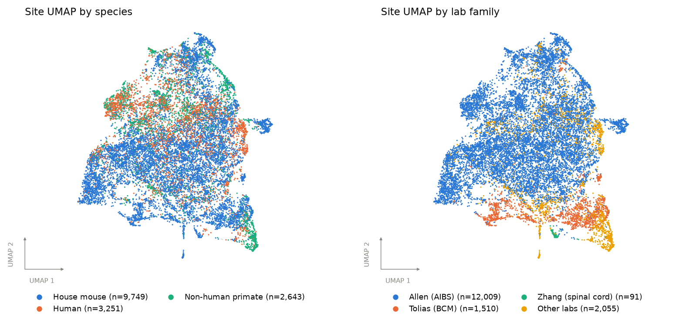
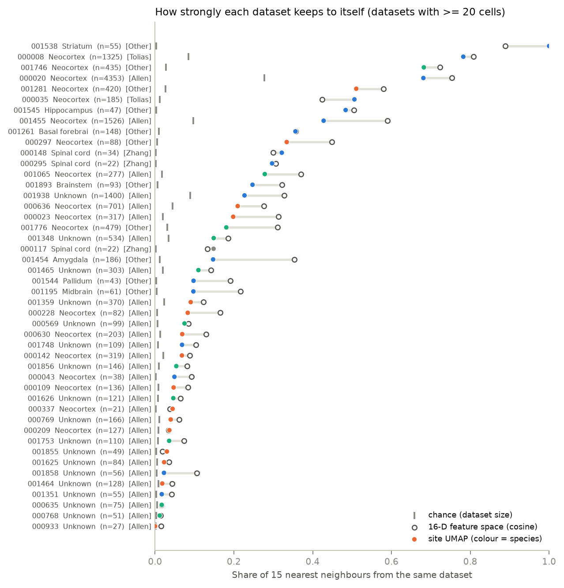

The most self-contained datasets are almost all single-region, non-Allen sets:

- 001538 striatum
- the Zhang spinal-cord sets
- 001545 dentate gyrus
- 000297 UHN human
- 000035 / 000008 Tolias motor cortex
- 001893 locus coeruleus
- 001261 basal forebrain

The large Allen sets sit at 2–5× chance.

## 2. Biology vs. batch

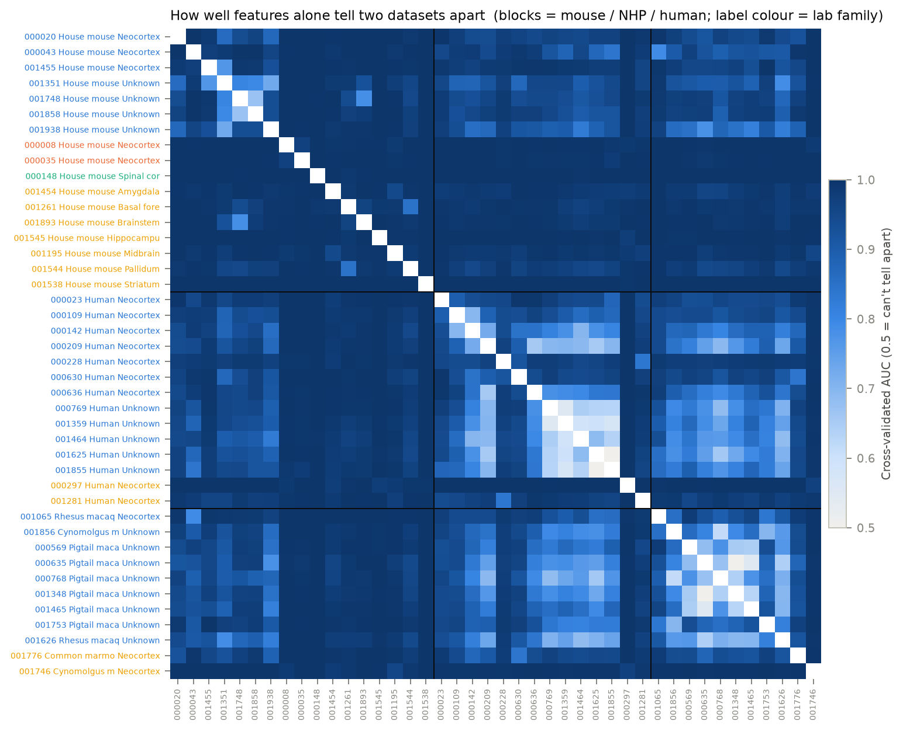
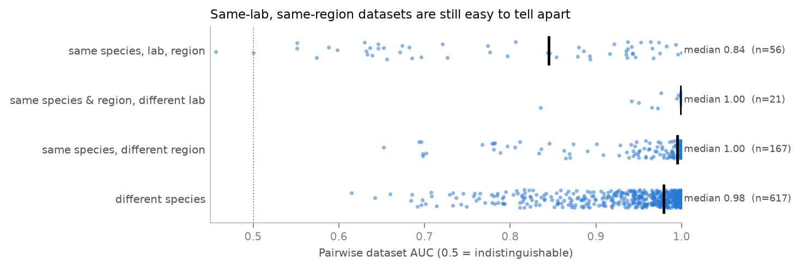

The pairwise-AUC matrix is the clearest picture.

- Every non-Allen dataset (orange/green labels) is separable from **everything** at AUC ≈ 1.0, including other
  human neocortex sets.
- The Allen human block and the Allen NHP block are pale (AUC 0.55–0.8), even *across* species.
- So "which rig" is a bigger axis than "which primate".

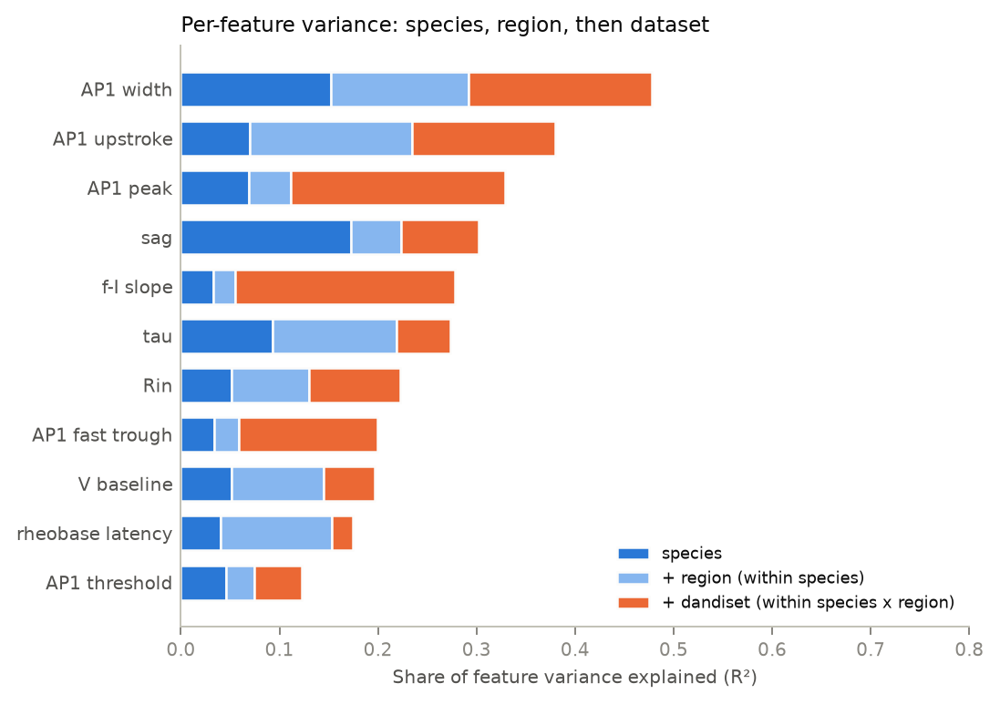

**Variance partition** (`variance_partition.csv`). The extra R² from dandiset, beyond species × region:

- **largest:** AP peak (0.20–0.22), AP width (0.19–0.20), upstroke (0.15), fast trough (0.14–0.16), rheobase
  rate (0.11)
- **smallest:** latency (0.02), threshold (0.04–0.05), V baseline (0.05), tau (0.05)

The spike-shape features carry the batch; threshold and passive features are comparatively clean.

**A caveat on the control pairs.** I first used 000020 vs 001455 (both Allen mouse V1) as a "should mix"
control, and they barely mix (0.18–0.31). However, 000020 is 25% fast-spiking and 001455 has *no* FS cells.
000020 appears to be the GABAergic-focused patch-seq release, so cell class is confounded. Even when AP width
is matched, they separate at AUC 0.94–0.95, driven by a 12–14 mV higher AP peak in 001455. That could be cell
class (interneuron vs. pyramidal) or a rig/era change; the CSV can't tell which. The pair is reported but kept
out of the control average.

## 3. Technical drivers

### Recording temperature: large, and uncorrectable without metadata
000008 (room temperature) and 000035 (temperature-controlled) come from the same lab, region, protocol and
25 kHz sampling (`temperature_000008_vs_000035.csv`). In the warm set:

- AP width is 0.59× (1.16 → 0.68 ms)
- AP peak is about 10 mV lower
- sag is 1.6×
- Rin is 0.86×

The two sets mix at only about 0.39 of random in the site UMAP (three seeded refits). Temperature is not in the
DANDI metadata for most sets, so this cannot be regressed out. It is a plausible major reason AP width separates
labs, though this one pair is the only direct evidence here.

### Sampling rate: tracks spike kinetics across datasets, but explains little of it
Per-cell rates from the raw NWB files (`sampling_rates.csv`):

| sampling rate | datasets |
|---|---|
| mostly 50 kHz | nearly all Allen sets, plus 001776 and 001893 |
| **10 kHz** | 000117, 000148, 000245, 000295, 001195, 001261, 001454, 001538, 001544, 001545; 000297 is 73% 10 kHz |
| 25 kHz | 000008, 000035 |
| mixed | 000209, 000228, 000337, 001281 (42–100 kHz), 001746 (55% 50 kHz, 45% 25 kHz) |

Across datasets with ≥20 cells, the median rate tracks upstroke (Spearman ρ = 0.64) and width (ρ = −0.55). The
10 kHz sets have median upstrokes of 46–273 mV/ms and widths of 1.0–3.2 ms; most 50 kHz sets sit near 300 mV/ms
and 0.6–1.0 ms.

That does not show that sampling causes the difference:

- No dataset has both 10 and 50 kHz cells, so the 10 kHz effect is confounded with lab and region (mostly
  non-cortical sets, plus 000297 from human cortex).
- 001454 is 10 kHz with a near-Allen upstroke (273 mV/ms).
- Within mixed datasets, rates from 41.7 to 200 kHz show no consistent effect.
- 001746 goes the other way: its 50 kHz cells look slower than its 25 kHz cells (upstroke 123 vs 240 mV/ms, width
  3.3 vs 2.0 ms). That points to a split inside the dataset and is worth a look.

**Direct test: sampling explains little of the gap.** `tools/downsample_test.py` took 545 cells recorded at
exactly 50 kHz (6 Allen datasets, fast-spiking and other cells), degraded their sweeps and reran the same feature
extraction. Undegraded, it reproduces the database exactly on all 13 features checked, so every difference
below comes from the degradation. Results are in `figures/downsampling_test/`.

| feature | real gap, 10 vs 50 kHz sets | 10 kHz | 10 kHz + 5 kHz Bessel | 10 kHz + 2 kHz Bessel |
|---|---|---|---|---|
| upstroke (mV/ms) | −169 | −58 | −68 | −105 |
| width (ms) | +0.87 | +0.08 | +0.10 | +0.12 |
| peak (mV) | −15 | −0.4 | −0.9 | −3.9 |
| threshold (mV) | −5.2 | −0.5 | −0.5 | −0.7 |

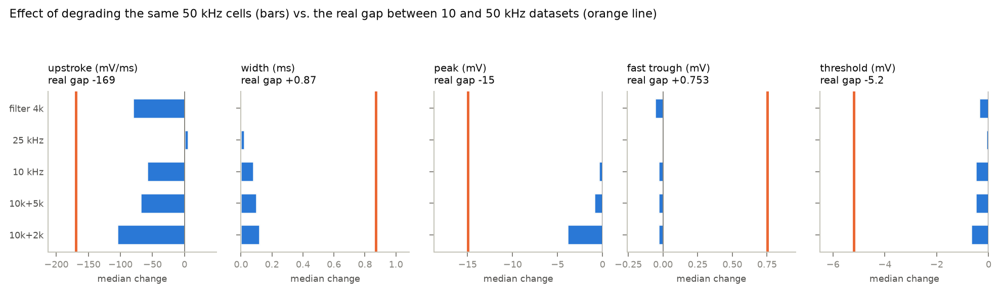
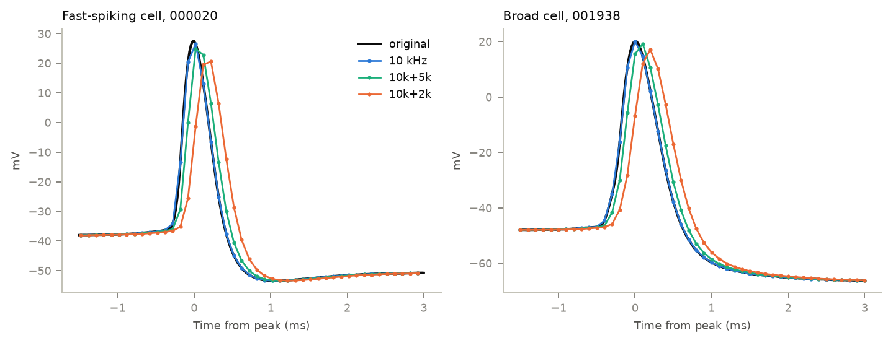

- **Width, peak and threshold:** the real gaps are mostly not sampling: 9–14% of the width gap and 10–13% of the
  threshold gap. Peak is 3–6% except under the heavy 2 kHz filter (26%), which mainly clips fast-spiking cells.
- **Upstroke:** the only feature with a large effect, and that table overstates it for real 10 kHz cells, because
  slower spikes lose less. The test cells lost 25% above 400 mV/ms but only 7–11% below 150 mV/ms, and the 10 kHz
  sets have a median upstroke of 135. Extrapolating, sampling accounts for roughly 6–15% of the upstroke gap.
- **Our analysis filter does the upstroke damage, not the resampling.** The pipeline caps its dv/dt filter at
  0.8 × Nyquist, so 10 kHz data is filtered at 4 kHz and 50 kHz data at 10 kHz. Applying the 4 kHz filter to
  undecimated 50 kHz data lowers upstroke by 25%, more than decimating to 10 kHz does (18%). It leaves width and
  peak untouched, since those are measured on the unfiltered voltage.
- **Unaffected:** input resistance, tau, V baseline, sag, latency, f-I slope and fast trough barely move (at most
  0.1%). 25 kHz has almost no effect on anything (upstroke +2%).
- **Position on the map:** degrading moves a cell less than the typical distance to its neighbours (median cosine
  distance 0.016–0.021, or 0.058 at 2 kHz, against 0.072). Neighbours from real 10 kHz sets go from 1.3% to
  2.4–3.7%, still below their 4.4% share of the database. Degraded Allen cells do not become like 10 kHz cells.

So 10 kHz sets differ mainly for other reasons: lab, region, cell type or temperature. For example, 001538's 1.9 ms
spikes would be about 0.1 ms wider from sampling.

Limits of the test: all test cells are from Allen rigs, the real sets' analog filters are unknown, and the Allen
traces already carry their own acquisition filter. At 10 kHz, width is also quantized to 0.1 ms steps. One cell of
the 545 (in 001359) stopped reaching the spike-detection criteria once degraded.

Removing the upstroke and width features gives the largest single drop in batch score, 1.88 → 1.67
(`feature_ablation.csv`), whatever the cause.

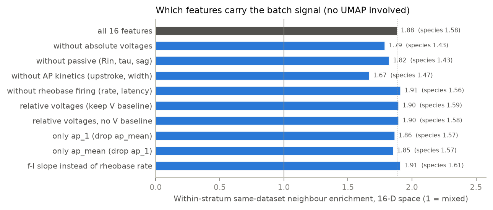

### Voltages: no junction-potential offset; AP peak spread is physiological
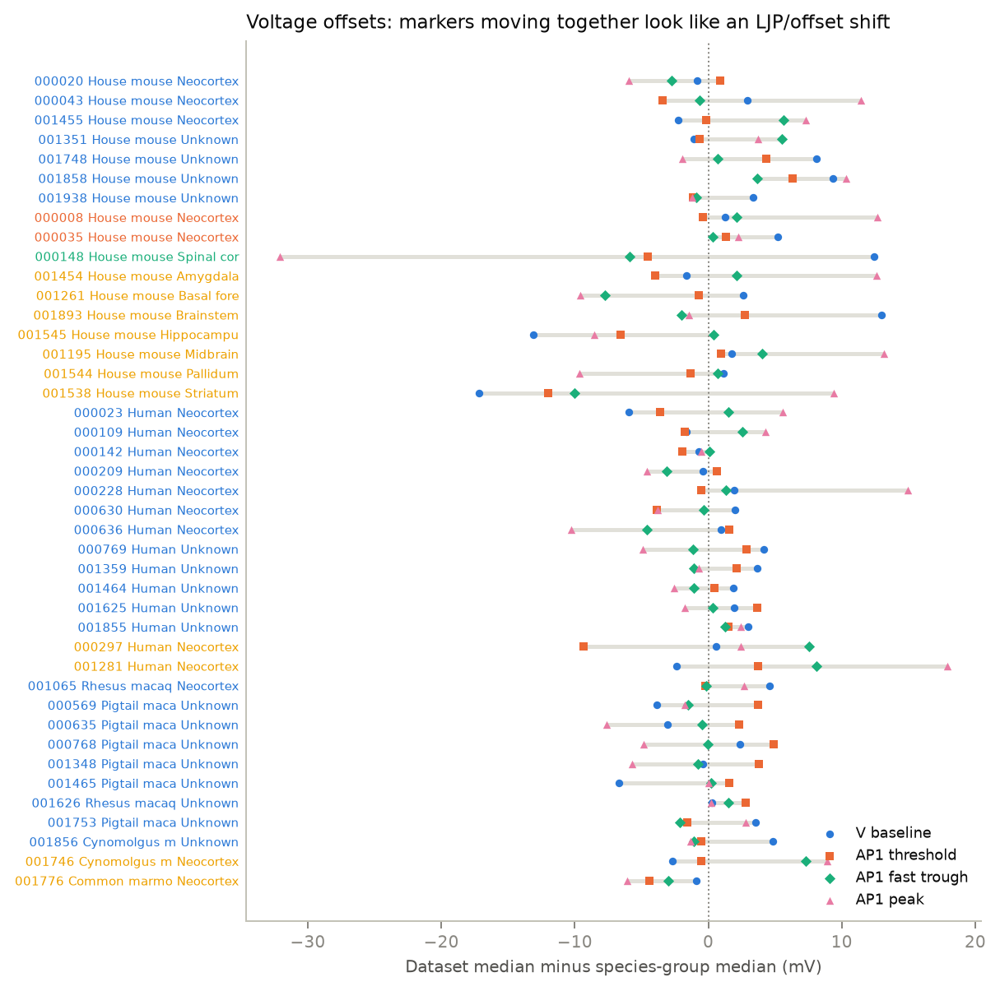

If an LJP or offset were the problem, V baseline, threshold and trough would all shift together within a
dataset. Mostly they don't; most datasets are within ±5 mV. Consistent with this, swapping to LJP-invariant
relative voltages (threshold−baseline, peak−threshold, trough−threshold) does not improve mixing (1.90 vs 1.88).

The marker that wanders is **AP peak** (±10–18 mV, SD of dataset medians 9.6 mV), independent of the others.
That spread is within the normal biological range. Within each lab, the median peak of fast-spiking cells sits
14–23 mV below that of broad-spiking cells:

| lab | FS | broad |
|---|---|---|
| Allen | 24.8 mV | 38.9 mV |
| Tolias | 26.6 mV | 49.1 mV |
| other labs | 23.7 mV | 42.3 mV |

A crude three-bin class adjustment (FS / intermediate / broad) does not shrink the dataset spread (9.6 → 9.8 mV).
Finer types (e.g. L5 ET vs IT, region-specific cells) are not captured by those bins, so composition, rig
compensation and temperature cannot be told apart here. Treat AP peak as accepted heterogeneity, not
something to correct or QC.

The two clear co-shifts are 001538 (all lower; already judged SPN biology) and 001545 (dentate granule
cells).

### Step protocol: the rheobase rate is mostly 1 / step length
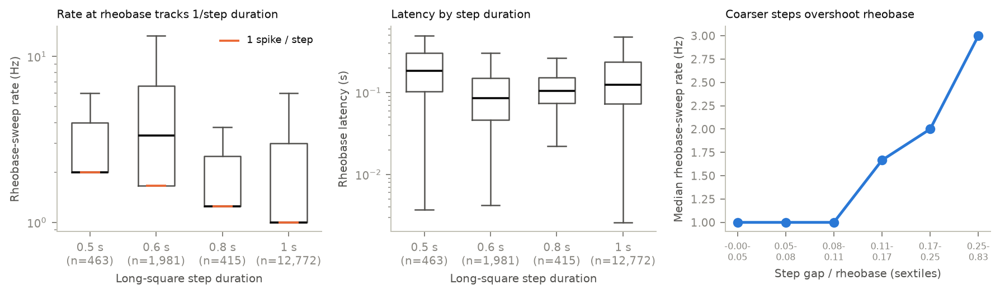

54% of cells fire exactly one spike on their rheobase sweep, so `avg_rate_0_long_square` is just 1/step
duration:

| step length | rate for one spike | datasets |
|---|---|---|
| 0.5 s | 2 Hz | 001261, 001454, 001538, 001544, 001545 |
| 0.6 s | 1.67 Hz | 000008, 000035, 001746 |
| 1 s | 1 Hz | the rest |

Coarse current steps also overshoot rheobase and inflate the rate. This feature carries protocol, not
physiology; it is the top distinguishing feature of the 000008 islands. Swapping it for the f-I slope
(`fi_linear_fit_slope`, 100% coverage) is cleaner in principle, but it doesn't measurably change the overall
mixing (1.88 vs 1.84).

### Not a problem
- **Imputation:** only 83 cells have any imputed feature, and no dataset is entirely missing one.
- **Redundancy:** the `ap_1_*` / `ap_mean_*` pairs correlate at r = 0.97–0.98, so AP shape is effectively
  double-weighted. Dropping one set is harmless (1.82 vs 1.84) and simplifies the matrix.

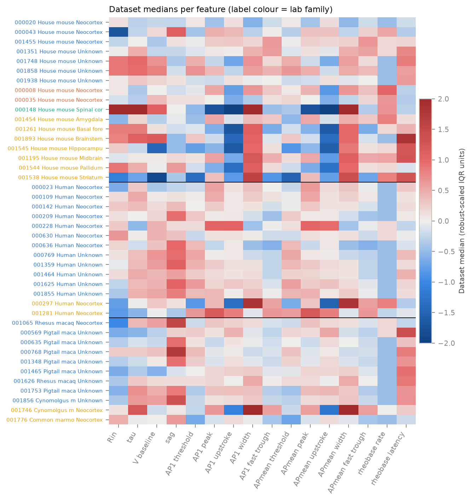

## 4. Islands and clusters (`islands.csv`, `clusters_vs_dandiset.csv`)

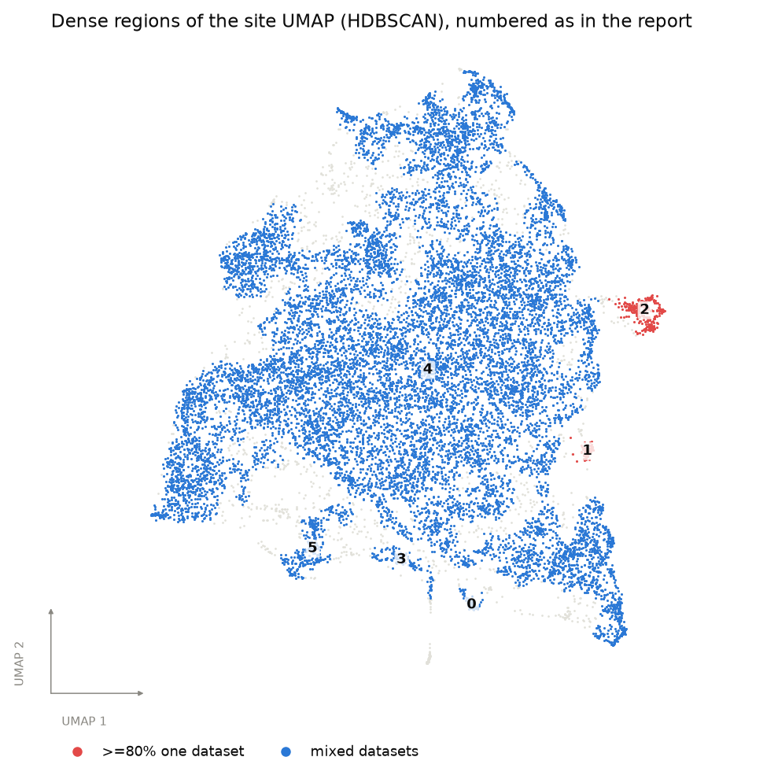

HDBSCAN finds one main body of 13,815 cells and five small dense islands. No cells are dropped or flagged.

| island | n | composition | distinguishing features | verdict |
|---|---|---|---|---|
| 2 | 262 | 82% 001455 | fast trough +1.2, sag +0.7, Rin −0.6 | unresolved: cell-class sampling vs. rig/era (see §2) |
| 5 | 315 | 78% 000008, 15% 000035 | rheobase rate +1.3, upstroke −0.7 | technical: 0.6 s steps, 25 kHz, room temperature |
| 3 | 124 | 73% 000008, 14% 001545 | rheobase rate +1.3, threshold −1.0 | technical, as above |
| 1 | 64 | 86% 000035 | fast trough +1.3, Rin −1.2 | mostly temperature (warm) |
| 0 | 83 | Zhang spinal-cord sets, plus some 001261 | upstroke −3.5, width +2.3 | mostly biology (spinal cord); all 10 kHz, so sampling may contribute |

The clustering is not batch-driven:

- coarse clusters: AMI vs. dandiset 0.14, none more than 80% one dataset
- fine clusters: AMI 0.21, none more than 80% one dataset
- the flat 20-component GMM: AMI 0.25, with 4 single-dataset clusters

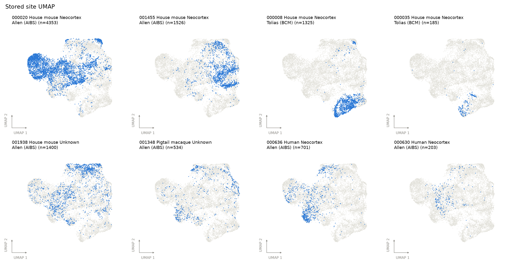

## 5. Light-touch variants (`scores_variants.csv`)

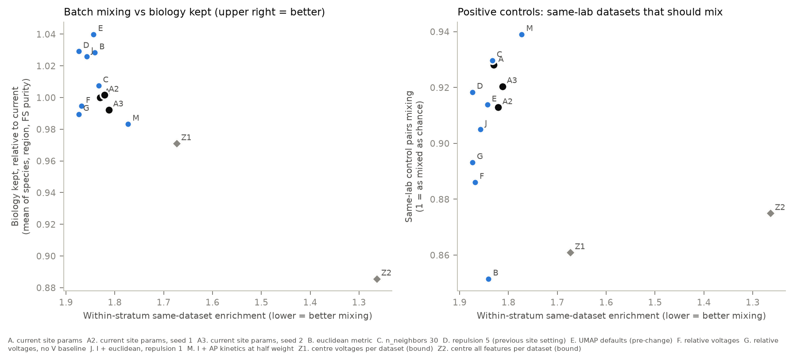

| variant | within-stratum (now 1.84) | species purity (now 1.45) | FS purity (now 5.6) | control mixing (now 0.91) | trust (now 0.93) |
|---|---|---|---|---|---|
| A2/A3. current, other seeds | 1.85 / 1.85 | 1.45 | 5.6 | 0.93 / 0.91 | 0.93 |
| B. euclidean | 1.86 | 1.48 | 6.0 | 0.86 | 0.96 |
| C. n_neighbors 30 | 1.86 | 1.48 | 5.6 | 0.88 | 0.93 |
| **D. repulsion 1** | **1.81** | 1.39 | 5.4 | **0.96** | 0.91 |
| E. UMAP defaults (pre-change) | 1.84 | 1.46 | 5.8 | 0.95 | 0.92 |
| F/G. relative voltages | 1.87 / 1.89 | 1.46 | 5.7 | 0.91 / 0.88 | 0.90 |
| H. drop ap_mean | 1.82 | 1.44 | 5.4 | 0.88 | 0.93 |
| I. F + H | 1.85 | 1.46 | 5.4 | 0.90 | 0.89 |
| J. I + euclidean + repulsion 1 | 1.79 | 1.42 | 5.2 | 0.91 | 0.88 |
| K. f-I slope for rheobase rate | 1.88 | 1.47 | 5.7 | 0.91 | 0.93 |
| L. I + K | 1.90 | 1.48 | 5.6 | 0.90 | 0.89 |
| M. I + AP kinetics at half weight | 1.74 | 1.42 | **4.7** | 0.94 | 0.87 |
| Z1. centre voltages per dataset | 1.70 | 1.35 | 5.6 | 0.89 | 0.92 |
| Z2. centre all features per dataset | 1.35 | 1.17 | 4.6 | 0.87 | 0.82 |

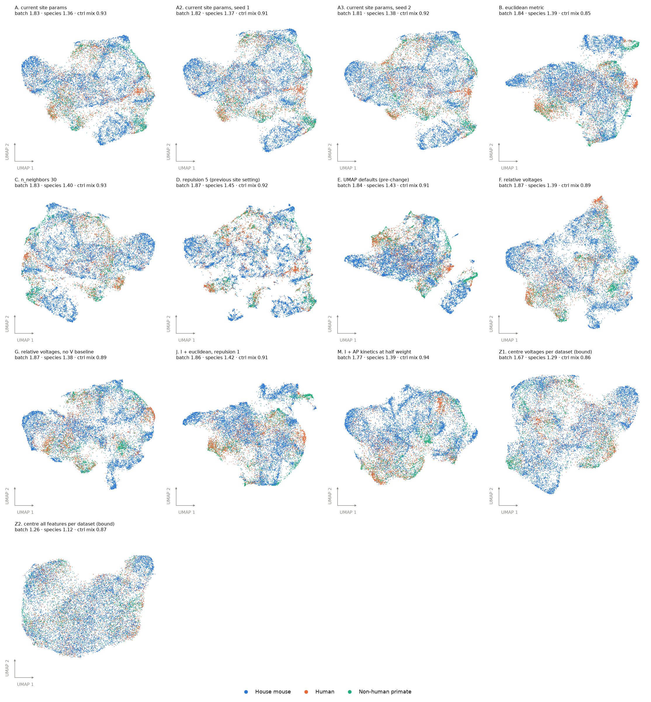

## Recommendations (ranked; none applied)

1. **Don't add batch correction to the main map.** Even the strongest correction (Z2 / the existing norm UMAP)
   trades about 20% of species structure and 19% of FS structure for mixing, and it would erase real
   single-region datasets such as 001538. Keep the norm UMAP as an explicitly labelled
   "per-dataset normalised (over-corrects)" view.
2. **Show the confounds instead of hiding them.** Add colour-by options to the explorer for lab family,
   sampling rate, step duration and (where known) temperature. Sampling rate needs a per-cell field from
   extraction; it is only sampled at this stage of the report. A short note on the site ("neighbourhoods are reliable within
   a lab family") would set expectations.
3. **Optional small embedding tweak: `repulsion_strength=1`** (variant D, in `database.py` `reducer2`).
   - Gains: best control-pair mixing (0.96 vs 0.91) and a small batch gain (1.81).
   - Costs: about 5% species purity, and trustworthiness 0.93 → 0.91.
   - Only worth it if the current look isn't specifically wanted.
4. **Feature hygiene, neutral on mixing, cleaner meaning** (`config.COLS_TO_KEEP`):
   - drop the `ap_mean_*` set (r ≥ 0.97 with `ap_1_*`)
   - consider replacing `avg_rate_0_long_square` with a log f-I slope, since the rheobase rate mostly encodes
     step length

   Neither will visibly reduce batch.
5. **Not recommended:**
   - relative / LJP-invariant voltages: no gain
   - down-weighting AP kinetics (M): it buys the most mixing, but it costs 16% of FS separation, which is the
     clearest real biology axis
6. **Housekeeping:**
   - `database.py:291` logs "Dumping dataset_numeric" but the `joblib.dump` is commented out. Re-enabling it
     would let future workups use the merge's exact matrix instead of a rebuild.
   - 22 Allen HMBA/BICAN dandisets still have `brain_region = Unknown`, and 000117 has no species. These limit
     how finely biology can be separated from batch.
